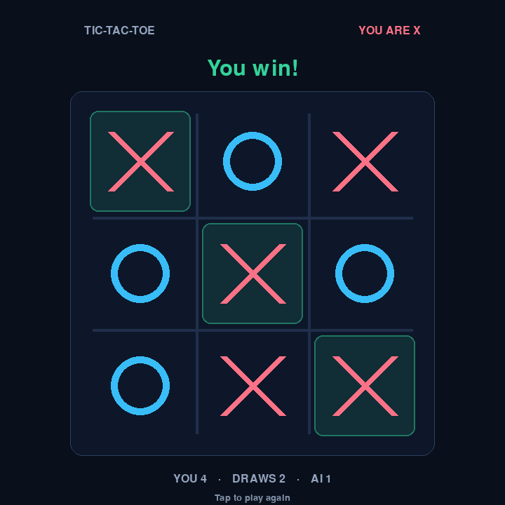
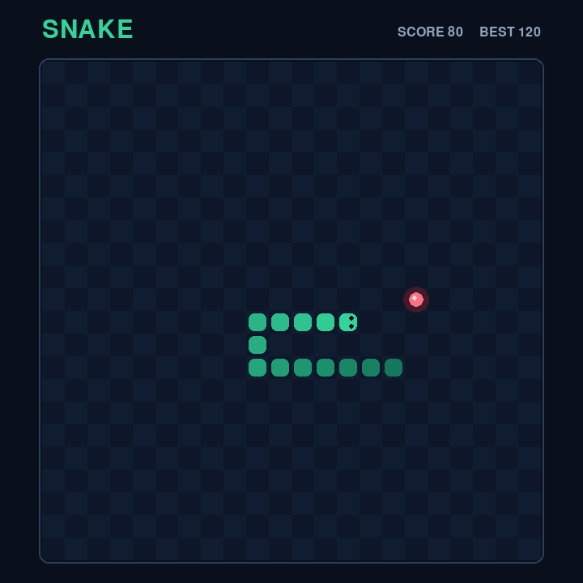

# Arcade / Classic

Two classic games rebuilt in Python with **pygame-ce**, running entirely in the
browser through **Pyodide** (CPython 3.14 → WebAssembly). Static hosting on
GitHub Pages, no backend, no build step for the games.

Games: **Tic-Tac-Toe** (minimax AI) and **Snake** (fixed-timestep grid loop).

| Tic-Tac-Toe | Snake |
|---|---|
|  |  |

Both images are rendered from the real pygame scenes by
`tools/screenshots.py` (`SDL_VIDEODRIVER=dummy`), so they double as a visual
smoke test.

## Why this stack

- One language for rules, rendering and tests.
- Game logic is pure Python, so `pytest` plays it without a browser.
- The runtime boots once and swaps scenes, so the second game starts instantly.
- Hosting is plain static files: GitHub Pages serves the site for free.

The trade-off is a ~12 MB runtime download on first launch. Play buttons are
deliberately the trigger, so the landing page and docs stay instant.

## Run it

```powershell
# static server (needed: ES modules and fetch do not work from file://)
python -m http.server 8000
# open http://localhost:8000
```

```powershell
# tests + docs (creates an isolated environment)
python -m venv .venv
.\.venv\Scripts\python.exe -m pip install -r requirements-dev.txt
.\.venv\Scripts\python.exe -m pytest -q
.\.venv\Scripts\python.exe tools\build_docs.py
```

```powershell
# same scene in a desktop pygame window, for debugging
.\.venv\Scripts\python.exe tools\dev_run.py snake
.\.venv\Scripts\python.exe tools\dev_run.py tictactoe
```

```powershell
# re-render screenshots/ from the real scenes (headless)
.\.venv\Scripts\python.exe tools\screenshots.py
```

## Layout

```text
index.html               single-page shell: hero, game cards, canvas stage
src/loader.js            Pyodide boot, module loading, rAF frame loop
src/controls.js          keyboard / touch / canvas taps -> actions
src/main.js              page lifecycle: play, close, progress, errors
src/router.js            #/play/<slug> hash routes
python/boot.py           entry point imported inside Pyodide
python/arcade/           engine: App, BaseScene, InputQueue, FixedStep, storage
python/games/snake/      logic.py (pure) + scene.py (pygame)
python/games/tictactoe/  logic.py + ai.py (pure) + scene.py (pygame)
tests/                   pytest: rules, AI, headless scene smoke tests
docs/                    Markdown build notes, rendered to HTML
screenshots/             rendered by tools/screenshots.py (README + docs)
tools/build_docs.py      Markdown -> HTML for GitHub Pages
tools/dev_run.py         desktop pygame runner
tools/screenshots.py     headless renderer / visual smoke test
manifest.json            list of Python files shipped to the browser
```

## Deploy

1. Push the repository to GitHub.
2. **Settings → Pages → Source: GitHub Actions**.
3. Push to `main`. `.github/workflows/deploy.yml` runs tests, renders docs and
   publishes the site.

Everything uses relative paths, so it works on a project page
(`username.github.io/repo/`) or a user page without changes.

## Before you publish

- Set `REPO_URL` at the top of `src/main.js` to your repository URL. While it is
  empty, the Source links remove themselves.
- Optional: add a `LICENSE` file (MIT is a good default for a portfolio).
- If you change Python code, bump `version` in `manifest.json` so browsers fetch
  the new modules instead of a cached copy.

## Read the notes

- [`docs/ARCHITECTURE.md`](docs/ARCHITECTURE.md) — boot sequence, frame loop,
  every main function, testing and deployment.
- [`docs/games/snake.md`](docs/games/snake.md)
- [`docs/games/tictactoe.md`](docs/games/tictactoe.md)
