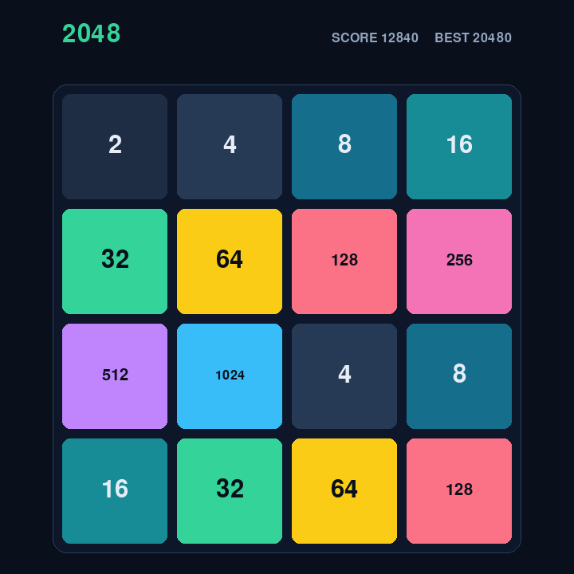

# 2048

The puzzle classic: slide the whole board, merge equal neighbours, and keep
going until a tile is worth 2048 (or the board locks up). Board state is a pure
16-cell tuple, so every move can be tested without pygame.



- Page: `/2048/` (`2048/index.html`).
- Controls: **arrows / WASD** slide, **P** pause, **R** restart, **Esc** back to
  all games. On touch screens the D-pad under the board does the same.
- High score persists in `localStorage` under `classic-games.v1` → `2048.best`.
- Score: the value of every tile created by a merge (a `4 + 4` merge adds `8`).

Source: `python/games/twenty48/` (`logic.py`, `scene.py`, `constants.py`).
The package is named `twenty48` because a Python module cannot start with a
digit; the page and the game are still called 2048.

## State

`State` is a frozen dataclass:

| Field | Type | Meaning |
|---|---|---|
| `board` | `tuple[int, ...]` | 16 cells in row-major order; `0` is empty. |
| `score` | `int` | Points accumulated by merges. |
| `over` | `bool` | True when no slide can change the board. |
| `ticks` | `int` | Number of effective moves; used by tests. |

Row-major order means cell `(column, row)` is `board[row * 4 + column]`.

## Main functions — rules (`logic.py`)

| Function | What it does | Why it is shaped this way |
|---|---|---|
| `new_state(rng)` | Empty board plus two spawned tiles. | RNG is injected, so `Random(7)` produces the same opening twice. |
| `spawn_tile(board, rng)` | Puts a `2` (90%) or `4` (10%) in a random empty cell. | One place decides the odds; it returns a new board. |
| `can_move(board)` | True while an empty cell or an equal neighbour exists. | Also the game-over predicate, so there is no second definition to drift. |
| `move(board, direction)` | Slides and merges every line, returning `(board, points, changed)`. | Pure and side-effect free: tests call it directly. |
| `slide(state, direction, rng)` | One player move: `move`, score, spawn one tile, recompute `over`. | Spawning only on a real change is the rule that punishes arrow-mashing. |
| `reached_target(board)` | Whether any tile is at least 2048. | Used by the HUD/extensions; the game keeps going after 2048. |

Merging works on one line at a time, left-to-right after a direction-dependent
transform:

```text
(2, 2, 2, 2) -> (4, 4, 0, 0)     two pairs, not one 8
(4, 4, 8, 0) -> (8, 8, 0, 0)     the new 8 does not merge again
```

- **Left** uses rows as they are.
- **Right** reverses each row, slides left, then reverses back.
- **Up** transposes the board, slides left, then transposes back.
- **Down** transposes and reverses, slides left, then undoes both.

## Scene (`scene.py`)

| Function | Responsibility |
|---|---|
| `build_scene(screen, fonts, scores)` | Factory used by `App.switch()`. |
| `Twenty48Scene.reset()` | New `State`, reload the stored best score. |
| `Twenty48Scene.on_action(action)` | Maps `LEFT/RIGHT/UP/DOWN` to `logic.slide`. |
| `Twenty48Scene._slide(direction)` | Applies the move and ends the round if the board locked up. |
| `Twenty48Scene._end_round()` | Saves a new best and calls `finish()`. |
| `Twenty48Scene.render(surface)` | HUD, 4×4 board, tiles, game-over overlay. |
| `Twenty48Scene._draw_tile()` | Empty slot or a coloured tile with a value that picks its own font size. |

There is no fixed-step timer: 2048 is turn-based, so `tick()` is unused and the
scene reacts only to actions. Pause, restart and tap-to-restart come from
`BaseScene` like the other games.

## Rendering notes

- Tile colours get brighter as the value grows; the text colour flips to the
  dark background once the tile is light enough to need contrast.
- Font size steps down at 100 and 1000 so five-digit tiles still fit.
- The board panel and slots are drawn every frame; there are only 16 of them, so
  caching would add complexity for no gain.

## Tests

`tests/test_2048_logic.py` covers: seeded openings, pair-merging once, no chained
merges, all four directions, no-op moves, spawn-on-change, deterministic
spawning, the game-over predicate, dead boards ignoring input, and the target
check.

`tests/test_scenes.py` drives the real scene: a move scores and spawns, every
draw call runs, and the game-over restart path resets the board.

## Tuning and extensions

| Constant | File | Effect |
|---|---|---|
| `CELL`, `GAP`, `BOARD_X/Y` | `constants.py` | Board geometry on the 720×720 canvas. |
| `SPAWN_FOUR_CHANCE` | `constants.py` | Probability a new tile is a 4 (default 0.1). |
| `TARGET` | `constants.py` | The celebrated value (2048). |

Ideas that fit the current split:

- **Slide animation** — keep the previous board and interpolate tile positions,
  similar to Snake's `_prev_body`.
- **Undo** — a stack of `State` values; undo is just `states.pop()`, no rules
  changes.
- **Win card at 2048** — check `reached_target` after each slide and show a
  “Keep going” overlay that does not call `finish()`.
- **Swipe input** — map `pointerdown`/`pointerup` deltas in `controls.js` to the
  four actions; Python needs no change.
