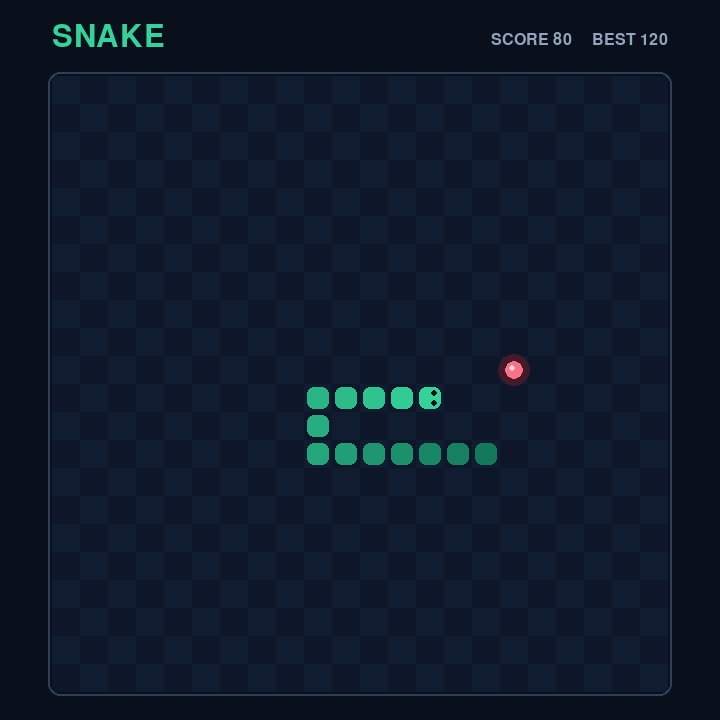

# Snake

The grid classic: eat the coral dots, grow, and never touch a wall or your own
tail. The board is 22×22 cells of 28 px, drawn on a fixed 720×720 logical canvas.



- Controls: **arrows / WASD** steer, **P** pause, **R** restart, **Esc** close.
- High score persists in `localStorage` under `classic-games.v1` → `snake.best`.
- Score: **10 points per dot**. Speed increases with score.

Source: `python/games/snake/` (`logic.py`, `scene.py`, `constants.py`).

## State

`SnakeState` is a frozen dataclass. `step()` returns a new state instead of
mutating the old one, so a test can keep the previous tick around and compare.

| Field | Type | Meaning |
|---|---|---|
| `cols`, `rows` | `int` | Board size in cells (default 22×22). |
| `body` | `tuple[Point, ...]` | Snake cells, **head first**, tail last. |
| `direction` | `(dx, dy)` | Direction of the last applied move. |
| `pending` | `tuple[Direction, ...]` | Buffered turns, max two, applied one per tick. |
| `food` | `Point \| None` | Current dot, or `None` on a full board. |
| `score` | `int` | 10 points per dot. |
| `alive` | `bool` | False after wall/self collision. |
| `ticks` | `int` | Number of grid moves performed; used by tests. |

Directions are tuples: `RIGHT = (1, 0)`, `UP = (0, -1)` (y grows downward).

## Main functions

| Function | What it does | Why it is shaped this way |
|---|---|---|
| `create_state(cols, rows, rng)` | Builds a length-3 snake at the board centre, moving right, and places the first food. | RNG is injected, so `Random(7)` always produces the same board. |
| `random_empty_cell(state, rng)` | Uniformly chooses a cell not occupied by the snake. | Guarantees food never spawns under the body; returns `None` when full. |
| `queue_direction(state, direction)` | Appends a turn to `pending`. Rejects reversals, duplicates and a third buffered turn. | Two buffered turns let a fast "up then left" corner register inside one tick without allowing self-kill by pressing the opposite arrow. |
| `step(state, rng)` | One grid tick: resolve the next direction, move the head, eat/grow, detect walls and self, respawn food. | Every rule lives here; rendering never changes state. |
| `interval_for(score)` | `max(0.065, 0.135 - 0.0005 × score)` seconds per tick. | The speed ramp is a pure formula, so it is trivial to test and tune. |

`scene.py` then holds only presentation concerns:

| Function | Responsibility |
|---|---|
| `build_scene(screen, fonts, scores)` | Factory used by `App.switch()`. |
| `SnakeScene.reset()` | New `SnakeState`, cleared accumulator, reload best score. |
| `SnakeScene.on_action(action)` | Maps `Action.LEFT/RIGHT/UP/DOWN` to `queue_direction`. |
| `SnakeScene.tick(dt)` | Asks `FixedStep` how many grid moves are due, applies them, handles death. |
| `SnakeScene._end_round()` | Updates `snake.best` and calls `finish()`. |
| `SnakeScene.render(surface)` | Board, food, snake, HUD, game-over overlay. |
| `SnakeScene._draw_snake()` | Draws tail → head with a colour gradient, then two eyes based on direction. |

## One tick, in order

1. Take `pending[0]` as this tick's direction (else keep `direction`).
2. Compute `head = body[0] + direction`.
3. **Wall check:** outside `0 ≤ x < cols` / `0 ≤ y < rows` → dead.
4. **Self check:** the new head is in the body — except the tail, which vacates
   this tick *unless* the snake is eating.
5. Grow if the head lands on food (`score += 10`), otherwise drop the tail.
6. On eating, spawn the next food on a free cell.

The tail rule matters: turning into the cell your tail is leaving is legal, and
`tests/test_snake_logic.py` locks that behaviour in.

## Timing

The snake never moves once per rendered frame. `FixedStep.advance(dt, interval)`
accumulates real time and returns how many whole grid ticks are due:

```text
score 0    -> 0.135 s / move  (~7.4 moves per second)
score 70   -> 0.100 s / move  (~10 moves per second)
score 140+ -> 0.065 s / move  (~15 moves per second, floor)
```

A single frame can therefore run zero, one, or several grid moves. The JS loop
clamps `dt` to 0.05 s and `FixedStep` clamps the accumulated frame to 0.25 s
(max 8 ticks), so returning to a background tab cannot teleport the snake.

## Rendering notes

- The checkerboard is rendered **once** into `_board_art` and blitted each frame;
  redrawing 484 rects per frame would be wasteful inside WebAssembly.
- Segments are rounded rects with a colour lerp from `MINT_DARK` (tail) to `MINT`
  (head), so the direction of travel is readable at a glance.
- Food pulses with `sin(time × 7)`; the glow is a darker coral circle behind it.
- The game-over overlay shows score, best, a `NEW BEST` badge and a pulsing
  "Press R or tap to play again". Tapping is handled by `BaseScene` with a
  0.55 s grace period.
- Pause is entirely inherited from `BaseScene`.

## Tuning

| Constant | File | Effect |
|---|---|---|
| `COLS`, `ROWS`, `CELL` | `constants.py` | Board size and pixel scale (616 px board, centred at x=52, y=76). |
| `BASE_INTERVAL` | `constants.py` | Starting seconds per move (0.135). |
| `MIN_INTERVAL` | `constants.py` | Speed floor (0.065). |
| `SPEED_PER_POINT` | `constants.py` | How fast the ramp is (0.0005 s per point). |
| `FOOD_SCORE` | `constants.py` | Points per dot (10). |
| `SEGMENT_INSET`, `SEGMENT_RADIUS` | `constants.py` | Segment look. |

## Tests

`tests/test_snake_logic.py` covers: seeded creation, single-cell movement,
reversal/duplicate rejection, buffered corners, growth + score + food respawn,
wall death, neck collision, tail-vacate legality, dead snake immobility, speed
floor/ceiling, and full determinism for a seeded run.

`tests/test_scenes.py` drives the real scene headless until it hits the wall,
restarts it with a tap, checks pause freezes the tick counter, and verifies
restart resets the round.

## Extensions worth trying

- **Wrap-around walls** — change the wall check into modulo arithmetic; add a
  mode flag so classic and wrap can coexist.
- **Interpolation** — `FixedStep.remainder / interval` gives the fraction toward
  the next cell; lerp segment positions for buttery motion at 144 Hz.
- **Obstacles** — add a `walls: frozenset[Point]` field and include it in both
  the collision check and `random_empty_cell`.
- **Swipe input** — map `pointermove` deltas in `controls.js` to the same four
  actions; the Python side needs no change.
- **SFX** — initialize `pygame.mixer` after the Play click (see `unlockAudio()`),
  then play OGG files on eat/death.
