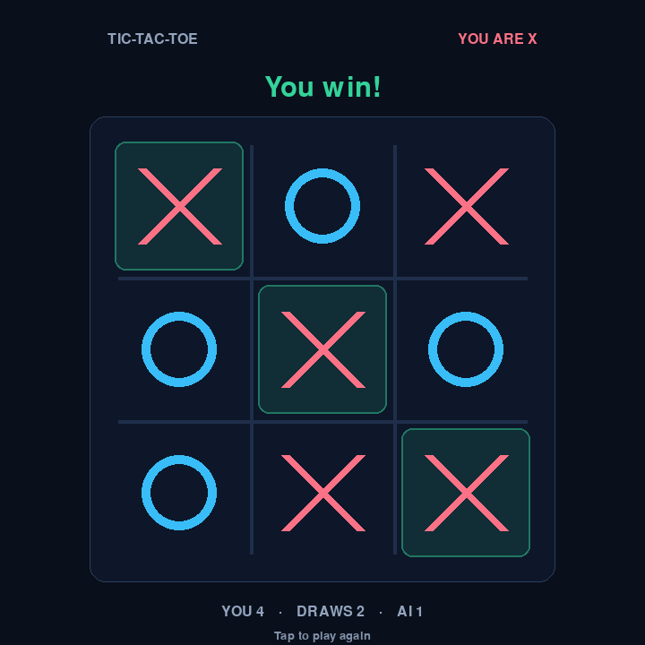

# Tic-Tac-Toe

You are **X** and always move first. The opponent is a memoized minimax search,
so a draw is the best available result. Wins, losses and draws are saved locally.



- Page: `/tic-tac-toe/` (`tic-tac-toe/index.html`).
- Controls: **click/tap** a square, **P** pause, **R** restart, **Esc** back to
  all games.
- Stored counters: `ttt.wins`, `ttt.losses`, `ttt.draws` under `classic-games.v1`.

Source: `python/games/tictactoe/` (`logic.py`, `ai.py`, `scene.py`, `constants.py`).

## The board

A board is an immutable 9-tuple in row-major order:

```text
 0 | 1 | 2
---+---+---
 3 | 4 | 5
---+---+---
 6 | 7 | 8
```

`EMPTY = 0`, `X = 1`, `O = 2`, `DRAW = 3`. Because it is a tuple, it can be an
`lru_cache` key and a test oracle at the same time.

## Main functions — rules (`logic.py`)

| Function | Input → output | What it does |
|---|---|---|
| `new_board()` | → `(0,) * 9` | Empty board. |
| `other(player)` | `X ↔ O` | Swaps sides. |
| `legal_moves(board)` | board → `list[int]` | Indices of empty cells, in ascending order. |
| `apply_move(board, i, player)` | board → board | Returns a new tuple with the mark placed; raises `ValueError` on an occupied or out-of-range cell. |
| `winning_line(board)` | board → line or `None` | First of the 8 lines (3 rows, 3 columns, 2 diagonals) that is fully owned by one player. |
| `winner(board)` | board → `X`, `O`, `DRAW`, `None` | Outcome; `None` only while the game is running. |
| `is_over(board)` | board → `bool` | Convenience wrapper around `winner`. |

## The opponent (`ai.py`)

| Function | What it does |
|---|---|
| `position_value(board, player)` | Memoized **negamax**. Returns `+1` if the player to move can force a win, `0` for a draw, `-1` for a loss, assuming perfect play from both sides. |
| `best_move(board, player)` | Tries every legal move, scores it as `-position_value(reply, opponent)`, and returns the maximum. Ties break **centre → corners → edges**, which looks more natural to humans. |
| `choose_move(board, player, rng, difficulty)` | `easy` = random, `medium` = 35% random, `hard` = perfect. The scene always uses `best_move` (hard), but the difficulty hook is ready for a UI. |

**Why it is fast.** There are only 5,478 distinct reachable positions. Caching
`(board, player)` makes the entire tree effectively instant, even in WebAssembly.
The recursion is the classic negamax trick: your best score is the negation of
the opponent's best score in the position you hand them.

## The scene (`scene.py`)

| Function | Responsibility |
|---|---|
| `build_scene(screen, fonts, scores)` | Factory used by `App.switch()`. |
| `reset()` | New board, human to move, cleared result/win-line, reload counters. |
| `on_pointer(x, y)` | Ignore unless it is the human's turn and the round is live; map pixels to a cell; play X; hand the turn to O with a delay. |
| `_cell_at(x, y)` | Pixel → index in `0..8`, or `None` outside the board. Uses the 720×720 logical coordinates supplied by `controls.js`. |
| `_play(index, player)` | Apply the move, test for a line/draw, and on completion set `result`, store `win_line`, call `finish()` and `_record()`. |
| `tick(dt)` | Counts down `AI_DELAY` (0.45 s), then asks `best_move` for O and plays it. |
| `_record(outcome)` | Increments the matching counter exactly once per round and saves it. |
| `render(surface)` | Background, status line, panel, grid, win highlight, marks, score row, tap hint. |

Flow of one round:

1. Human click → `_cell_at` → `_play(index, X)`.
2. If nobody has won, `turn = O` and `ai_timer = 0.45`.
3. Every frame, `tick` subtracts `dt`. At zero it calls `best_move(board, O)`.
4. `_play` detects the outcome, calls `finish()` (base class) and records it.
5. The board stays visible with a pulsing **Tap to play again** hint. `R` also
   restarts immediately; a tap waits out the 0.55 s grace period inherited from
   `BaseScene` so the click that ended the game cannot instantly clear it.

## Rendering notes

- Board geometry: 160 px cells, 480 px board at `x=120, y=150`; the panel extends
  20 px around it; score row at y≈684 and the tap hint at y≈710.
- X is drawn as two 10 px coral strokes; O is a 10 px cyan ring. Both are inset
  38 px from the cell edge.
- The three cells of a completed line get a mint tint and outline, drawn
  **under** the marks.
- Status text changes with state: "Your turn", "AI is thinking…", "You win!",
  "The AI wins", "A draw".
- Pause overlay and restart handling come from `BaseScene`, not this file.

## Tuning

| Constant | File | Effect |
|---|---|---|
| `CELL`, `BOARD`, `BOARD_X`, `BOARD_Y` | `constants.py` | Board scale and position. |
| `AI_DELAY` | `constants.py` | Pause before the AI answers (0.45 s). |
| `MARK_INSET`, `MARK_WIDTH`, `GRID_WIDTH` | `constants.py` | Stroke sizes. |

## Tests

`tests/test_tictactoe_logic.py` covers every win direction, draw detection,
immutability, and illegal moves.

`tests/test_tictactoe_ai.py` proves behaviour instead of trusting it:

- `position_value(empty_board, X) == 0` — perfect play draws.
- the first move is the centre or a corner;
- the AI takes an immediate win instead of blocking;
- the AI blocks a single immediate threat;
- across 120 seeded games (AI as X and as O), the AI **never loses** to random;
- AI vs AI is a draw;
- `choose_move` at easy difficulty still returns legal moves.

`tests/test_scenes.py` plays a full round through the real scene: click, AI
delay, occupied-cell rejection, result recording, then restart.

## Extensions worth trying

- **Difficulty selector** — three buttons on the game page calling
  `boot.press("...")`, or a control that calls a new `boot.set_difficulty`
  function; `choose_move` already supports all three levels.
- **Alternate the starter** — keep a `starting_player` field in `reset()` so the
  AI opens every second round.
- **Best-of series** — store a series score and reset only when one side reaches
  three wins.
- **Undo** — keep a small stack of boards; add `Action.ACTION` handling to pop.
- **Bigger boards** — Connect Four is the same negamax shape with a different
  transition function and a depth limit (the 3×3 tree only stays tiny because
  the board is tiny).
